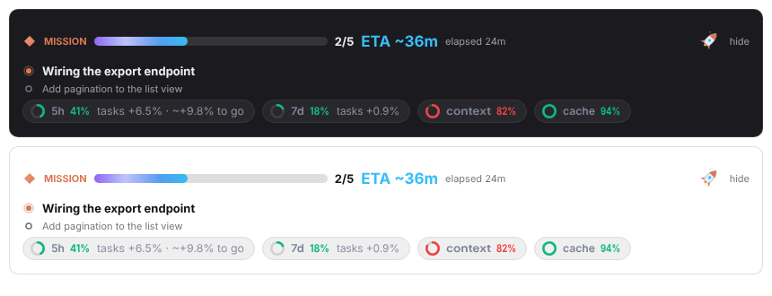

# mission-bar

[](https://github.com/Cogitoergo/claude-mission-bar/actions/workflows/ci.yml)
[](LICENSE)

A [Claude Code](https://code.claude.com/docs) mod that puts a bar above the
prompt showing where the current work stands: task progress, a live ETA, how
much of your 5-hour and weekly usage the tasks are costing, and when the
context is full enough that a new session would be cheaper.



*An illustration of the bar's drawings in the desktop app, on dark and light
backgrounds. The app's own fonts and spacing apply.*

In the terminal the same figures are drawn in coloured characters:

```
╭──────────────────────────────────────────────────────────────────────────────╮
│ ◆ MISSION ━━━━━━━━━━━━━━━━━━━━━━━━ 2/5 ETA ~36m elapsed 24m             hide │
│ ⠹ Wiring the export endpoint                                                 │
│ ○ Add pagination to the list view                                            │
│ 5h ▰▰▰▱▱▱▱▱ 41% tasks +6.5% · ~+9.8% to go   7d ▰▱▱▱▱▱▱▱ 18% tasks +0.9%     │
│ context ▰▰▰▰▰▱▱▱ 62%   cache ▰▰▰▰▰▰▰▰ 94%                                    │
│ ⚠ Context 62% full: plan a new session, or /compact, at the next natural     │
│   break.                                                                     │
╰──────────────────────────────────────────────────────────────────────────────╯
```

While a turn runs the progress bar shimmers and the task in progress pulses.
The apps animate their own drawings; the terminal redraws four times a second,
and only during a turn.

It makes no model requests. Every figure is one the session already holds, so
the bar adds nothing to your usage.

## What it shows

| Part | Where it comes from | Exact or estimated |
| --- | --- | --- |
| Progress bar, done/total, current and next tasks | The session's task list (`TaskCreate`, `TaskUpdate`, `TodoWrite`, `update_plan`) | Exact |
| ETA | Average working time per completed task, times the tasks left | Estimated |
| `5h` and `7d` fill | The rate-limit windows the last API response reported | Exact |
| `tasks +N%` | The window's fill now, less its fill when the first task was created | Exact |
| `~+N% to go` | Usage per working minute so far, times the ETA | Estimated |
| `context` | The context window's fill, as the status line reports it | Exact |
| `cache` | Share of the last turn's prompt served from the prompt cache | Exact |

Details worth knowing:

- **The ETA appears after the first task completes.** Before that there is no
  pace to go by, and the bar says so instead of guessing.
- **The ETA counts real time while work is under way**, including short
  pauses between turns such as a background command, and refreshes every 5
  seconds. A pause of more than ten minutes is taken as you being away and is
  not counted.
- **Tasks are only tracked when Claude keeps a task list**, which it does for
  multi-step work, or when you ask it to ("use your task list"). Steps Claude
  simply carries out one after another are not tasks the bar can see.
- **Without a task list the bar counts by prompt**: how long the running or
  last prompt took, the points it added to each window, the average per
  prompt, and roughly how many more prompts the 5-hour window has room for.
- **Without rate-limit readings** (an API key rather than a subscription, for
  example) the bar shows the session's cost in dollars instead.
- **A window that resets mid-run** is counted from zero from that point.

## Context and cache advice

| Condition | What the bar does |
| --- | --- |
| Context at 60% or more | Shows a note to plan a new session or `/compact` |
| Context at 80% or more | Turns the border red, recommends a new session, and shows a one-time toast |
| Last turn reused under 50% of its prompt from cache, with context at 30% or more | Notes that most of the context was paid for again |

The thresholds are constants at the top of [`hooks/estimate.ts`](hooks/estimate.ts).

## What the mod hooks

Every hook observes and passes the event on unchanged. None blocks, rewrites
or delays anything Claude does.

| Hook | What it does |
| --- | --- |
| `tool.call`, every tool | Lets the call run and returns its result untouched. For the task-list tools (`TaskCreate`, `TaskUpdate`, `TodoWrite`, `update_plan`) it then records each task's name and status for the bar. For every other tool it only counts the tool's name, in memory, for `/mission-bar debug`. |
| `turn.start`, `turn.complete` | Starts and stops the working-time clock and the refresh timer, and reads the turn's cache token counts. |
| `session.start` | Registers the `/mission-bar` command and takes a first usage reading. |
| `session.end` | Stops the timers, and clears the tracked tasks on `/clear`. |
| `command.run` for `/mission-bar` | Shows or hides the bar; `/mission-bar debug` prints diagnostics. This is the only command the mod adds; it adds no tools or agents. |
| `ui.render` for the band above the prompt | Draws the bar. |

The mod makes no network or model requests, runs no processes, and reads or
writes no files.

## Install

At the prompt of a terminal session:

```
/plugin install mission-bar --marketplace Cogitoergo/claude-mission-bar
```

From a shell:

```bash
claude plugin install mission-bar --marketplace Cogitoergo/claude-mission-bar
```

In the desktop app, where `/plugin` does not run: click **+** next to the
prompt box, then **Plugins**, **Add marketplace** with
`Cogitoergo/claude-mission-bar`, then **Add plugin**.

Choose the user scope to have the bar in every session on that machine.

## Use

The bar appears above the prompt once the mod is loaded. `/mission-bar`, or
the `hide` button on the bar, shows or hides it.

If the bar is missing tasks you expect, run `/mission-bar debug` after Claude
has used its task list and include the output in an issue: it names the tools
the mod saw, which shows how your build keeps its task list.

## Update

```bash
claude plugin update mission-bar
```

Then run `/reload-plugins` in a running session, or start a new one.

## Compatibility

Built and tested on Claude Code 2.1.321 and 2.1.322, on the terminal, desktop, VS Code and
mobile surfaces. The plugin API the mod uses is early access and can change
between Claude Code releases; if the bar stops drawing after an update, please
[open an issue](https://github.com/Cogitoergo/claude-mission-bar/issues).

## Contributing

See [CONTRIBUTING.md](CONTRIBUTING.md) for the project layout, how to run the
checks, and how branches and releases work. Changes are listed in
[CHANGELOG.md](CHANGELOG.md).

## License

[MIT](LICENSE)
